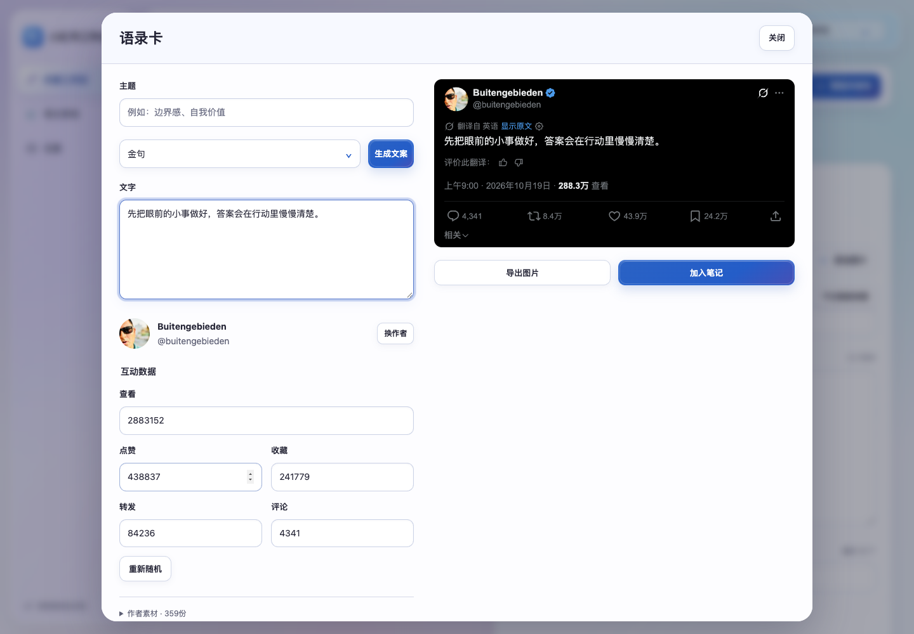

# XHS Content Workbench · 小红书内容工作台

把选题、写作、评论素材、拼图和发布放在一个本地工作台里。

[](https://github.com/melody240/xhs-content-workbench/actions/workflows/ci.yml)
[](LICENSE)
[](https://nodejs.org/)

**中文使用说明** · [快速开始](docs/QUICKSTART.md) · [MCP 与 Skills](docs/INTEGRATIONS.md) · [Windows 构建](docs/WINDOWS.md) · [架构](docs/ARCHITECTURE.md)

## 能做什么

- **内容工作区**：先选一个选题，接着准备标题、正文、话题与相关素材。支持最新、最热两种选题方向。
- **统一素材库**：X 帖子、抖音评论、小红书评论、本地图片集中管理；评论按评论自身点赞数筛选。图片点开预览、勾选、拖动排序。
- **语录卡**：输入文字或主题，生成黑底 X 风格图片，按内容原比例导出；内置 **359 组作者头像与昵称**，互动数据可编辑、再次随机。
- **3:4 拼图**：自定义背景，多张素材排布、标题编辑、保存素材与导出。
- **笔记发布**：图文、视频、本地草稿、发布预览、定时设置及本人账号后续评论；支持读取官方编辑器的智能标题，并采用第一个候选。
- **笔记表现**：从创作服务平台批量读取已显示的数据，切换近七日、近三十日。
- **本地管理**：账号分区、模型配置、任务进度、日志轮转与历史数据保留控制。

平台能力依赖当前登录、页面结构及账号权限。程序不会替你处理扫码、验证码或绕过访问限制。最终发布与评论须由使用者授权；返回不明确时需要到平台核查。



## 三步运行

需要 [Node.js 22+](https://nodejs.org/)、[Python 3.11+](https://www.python.org/downloads/) 和 Microsoft Edge。Windows 安装 Python 时勾选 **Add python.exe to PATH**。

```bash
git clone https://github.com/melody240/xhs-content-workbench.git
cd xhs-content-workbench
npm run setup
npm start
```

打开 **http://127.0.0.1:18180**。首次使用在工作台添加账号，进入「设置 → 连接概览」，按界面指引加载工作台生成的 Edge 扩展，在 Edge 登录平台，再回到工作台核实账号。[完整步骤与故障处理](docs/QUICKSTART.md)

工作台只监听本机地址；不要把服务端口或数据目录公开到互联网。模型调用所需密钥由使用者自行配置，调用可能产生所选服务商的费用。

## 整合了哪些 MCP 与 Skills

| 组件 | 在本项目中的角色 | 来源 / 许可 |
| --- | --- | --- |
| Xiaohongshu Skills | 日常操作使用的 Python CLI，保留五项上游 Skills；通过本项目适配器连接当前 Edge | [autoclaw-cc/xiaohongshu-skills](https://github.com/autoclaw-cc/xiaohongshu-skills) · MIT |
| XHS Skills Bridge | 本项目生成的带令牌 Edge 扩展，负责页面操作、账号核实、截图、智能标题与创作数据读取 | 本仓库 `workbench/integrations/` · Apache-2.0；提取的上游辅助代码保留 MIT |
| Xiaohongshu MCP | 可选的独立 Go MCP 服务，保留本地修改；使用自己的浏览器和登录会话 | [xpzouying/xiaohongshu-mcp](https://github.com/xpzouying/xiaohongshu-mcp) · Apache-2.0 |
| content-workbench Skill | 面向 AI 编程助手的工作台使用指南 | [SKILL.md](skills/content-workbench/SKILL.md) · Apache-2.0 |

五项上游 Skills：**xhs-auth / xhs-explore / xhs-interact / xhs-publish / xhs-content-ops**。详见 [集成、版本及参考项目](docs/INTEGRATIONS.md)。

默认启动工作台**不需要另开 MCP**。抖音、X 采集是本项目的浏览器扩展能力，不是额外运行的 MCP 服务。独立 MCP 不会自动复用 Edge 登录。

## 目录

```text
workbench/     Node 服务、前端、业务适配器、测试、上游 Skills
mcp/           可选 Go MCP 服务及原始许可证
skills/        本项目的工作台使用 Skill
desktop/       Windows Electron 启动器与构建配置
scripts/       安装、公开内容检查、Windows 资源准备
docs/          操作说明、架构、集成、素材来源与验证记录
.github/       自动测试和手动 Windows 构建工作流
```

## 开发与构建

```bash
npm run check
npm test
npm run audit:public
# 可选 MCP，在 mcp 目录中：
go test ./...
```

Windows 桌面版从本仓库源码构建，见 [构建与普通升级说明](docs/WINDOWS.md)。本仓库不携带作者电脑的开发环境、客户交付包或已登录浏览器。Windows 安装器的成功构建与 Windows 实机验收是两件事，具体边界见 [验证记录](docs/VERIFICATION.md)。

## 素材、隐私与使用边界

359 组头像、昵称及默认图片由项目维护者确认纳入公开分发，清单包含来源及文件哈希：[素材说明](docs/ASSETS.md)。第三方头像、名称、平台标志及截图中的权利仍归原权利人，**不自动适用本仓库代码许可证**。生成语录卡的文字及随机互动数不代表真实作者发布或真实平台数据，请勿用来冒充、伪造背书或误导他人。

账号、API 密钥、Cookie、浏览器资料、私人素材、草稿、历史记录、日志和扩展连接令牌均未随仓库发布。运行后新增的数据仍保存在你自己的电脑；调用模型时，相关资料会发送至你配置的服务商。

欢迎提交 Issue 和 Pull Request。反馈前请删除日志中的密钥、账号标识和私人内容。代码使用 [Apache-2.0](LICENSE)，第三方组件详见 [THIRD-PARTY-NOTICES.md](THIRD-PARTY-NOTICES.md)。本项目是社区工具，与小红书、抖音、X 无官方隶属关系。
